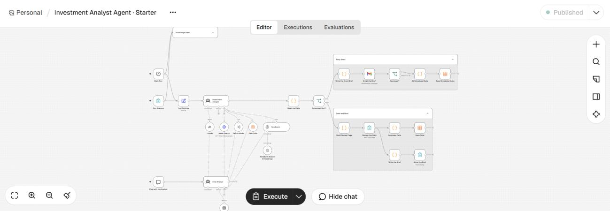
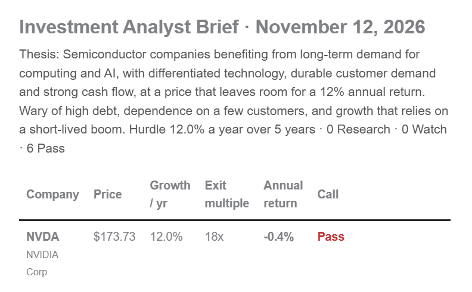
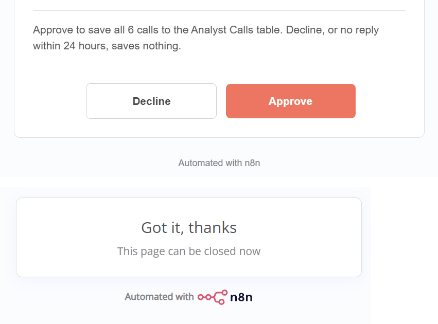
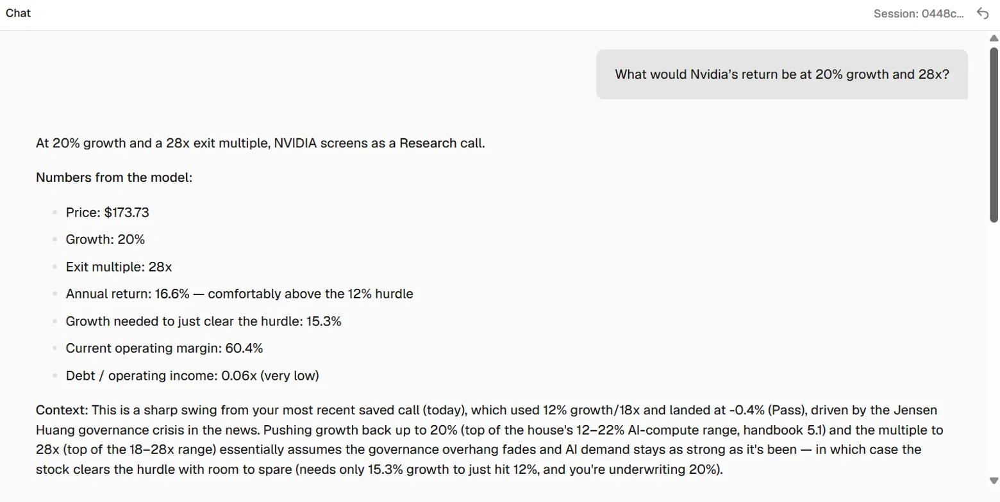

# Investment Analyst Agent: Semiconductors

An AI agent that covers six semiconductor companies against my investment thesis. Every weekday morning it pulls each company's latest SEC filing, stock price and news, sets valuation assumptions, runs a five-year return model in Python, checks a house handbook and its own past calls, and emails me a ranked brief. Nothing is saved to the record until I approve it.

Built in n8n with Claude (Anthropic API), as part of the Columbia Business School AI Club's "Build Your Own Investment Analyst Agent" workshop led by Professor Sunny Israni, CFA. I used Claude Desktop as a building assistant throughout.

## What it does

| Step | What happens |
|---|---|
| Trigger | Runs weekdays at 7:00 AM ET, or on demand from a form |
| Knowledge | Downloads my Semiconductor Coverage Handbook and indexes it for search |
| Research | For each company, the analyst searches the news, the handbook and its past calls |
| Judgment | The analyst chooses two assumptions: five-year revenue growth and an exit multiple, and explains why |
| Math | A Python model turns those assumptions into a year-five share price, an annual return and a call |
| Approval | The brief arrives by email with Approve and Decline buttons. Only approved calls are saved |
| Chat | A separate chat window lets me question the analyst. It reads the same tools but never saves anything |

**Watchlist:** NVIDIA (NVDA), Broadcom (AVGO), Applied Materials (AMAT), Synopsys (SNPS), Micron (MU), Texas Instruments (TXN)

**Thesis:** Semiconductor companies benefiting from long-term demand for computing and AI, with differentiated technology, durable customer demand and strong cash flow, at a price that leaves room for a 12% annual return. Wary of high debt, dependence on a few customers, and growth that relies on a short-lived boom.

## How it works

**The agent supplies judgment. Code supplies math.** The analyst never calculates anything itself. It picks growth and an exit multiple, then calls a separate Python tool that returns the result. Same inputs, same answer, every time.

**The model** (rewritten from a five-year return spreadsheet and checked against it):
1. Operating margin = operating income / revenue, held flat
2. Year-five revenue = revenue x (1 + growth)^5
3. Year-five enterprise value = year-five operating income x exit multiple
4. Year-five share price = (enterprise value + cash - long-term debt) / shares
5. Annual return = (year-five price / today's price)^(1/5) - 1

The model also returns the growth needed to clear the hurdle, debt divided by operating income, and a 3x3 sensitivity grid.

**The call:** Research if the annual return is at or above 12%, Watch if it is within 3 points below, Pass otherwise.

**Tools the analyst can use**

| Tool | What it does |
|---|---|
| Return Model | Pulls the latest 10-K figures from SEC EDGAR and the price from Yahoo Finance, then runs the Python model |
| News Search | Google News headlines from the last 7 days |
| Handbook | Searches the handbook (retrieval-augmented generation: 1,200-character chunks, OpenAI embeddings, top 5 matches) |
| Past Calls | Reads earlier saved calls for a ticker, so each reason says what changed |

## What I built on top of the workshop

The workshop provided a starter workflow, a pharma watchlist and a pharma coverage handbook. I adapted it to semiconductors and extended it:

- **Semiconductor watchlist and thesis**, chosen to cover different parts of the value chain and to test different parts of the thesis
- **Semiconductor Coverage Handbook** ([PDF](semiconductor-coverage-handbook.pdf)), drafted with Claude and reviewed by me. It sets house rules for debt, customer concentration and cyclical peaks, and gives growth and multiple ranges for each company. Two rules address weaknesses in the simple model:
  - *Peak margins (2.4):* the model holds today's margin flat, which overstates memory and equipment earnings at a cycle peak, so those companies use the low end of their ranges
  - *Acquisition amortization (2.3):* GAAP operating income understates earnings for large acquirers such as Broadcom and Synopsys, so their multiple ranges are set on a GAAP basis
- **Operating-loss guard** that flags companies whose model return is not meaningful
- **Fixes found while testing:** a ticker-matching bug that dropped one company's call, and a file-type issue when loading the handbook from GitHub
- **Daily email with approval**, replacing the in-app review page for scheduled runs

## Screenshots

**Daily brief by email**

**Approval**

**Chatting with the analyst**

## Known limitations

- Uses annual 10-K figures, long-term debt only, and cash only, so results can differ from a full model
- Ignores dividends and buybacks, which understates total return for companies such as Texas Instruments
- Holds operating margin flat for five years. The handbook adjusts for this, but the model does not
- Covers only US filers. Companies that file a 20-F under IFRS, such as TSMC and ASML, would need currency and ADR adjustments
- Reasons draw on news headlines, which can be incomplete or overstated. They should be checked before acting on them
- The analyst is sometimes more cautious than its own rules, for example cutting a multiple the handbook did not require
- Not yet scored against a formal test set (the workshop's optional evaluation step)

## Files

| File | Contents |
|---|---|
| `investment-analyst-agent.json` | Main n8n workflow: triggers, analyst, handbook, approval, email, chat |
| `tool-return-model.json` | The Return Model tool: SEC and price data plus the Python model |
| `semiconductor-coverage-handbook.pdf` | The house handbook the agent searches |
| `analyst-calls.csv` | Saved calls from the live run |

To run it yourself: import both JSON files into n8n, create a data table called "Analyst Calls", connect your own Anthropic and Gmail credentials, relink the Return Model tool, and set the recipient email.

---

*A learning project, not investment advice.*
